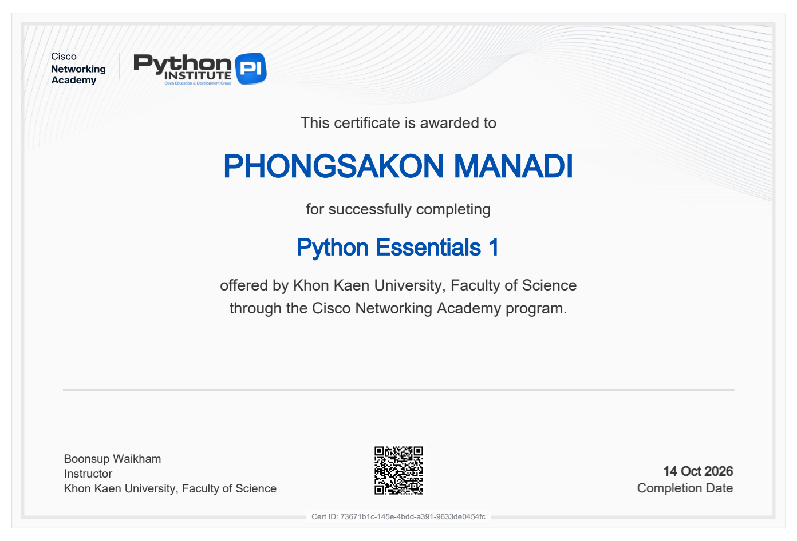
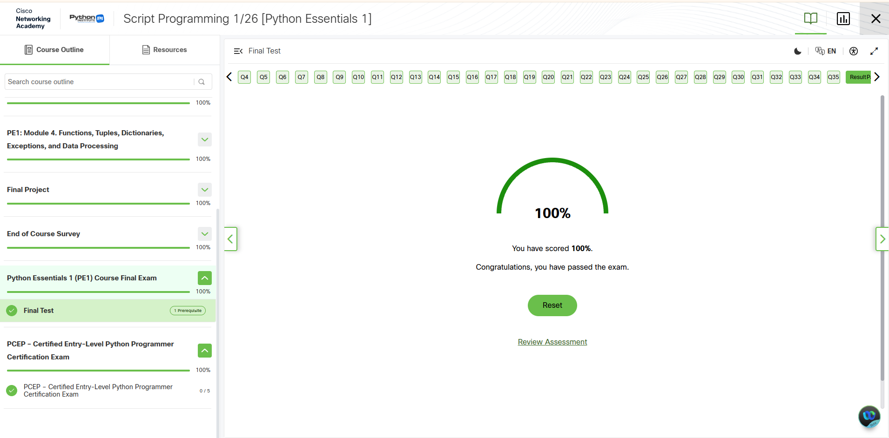
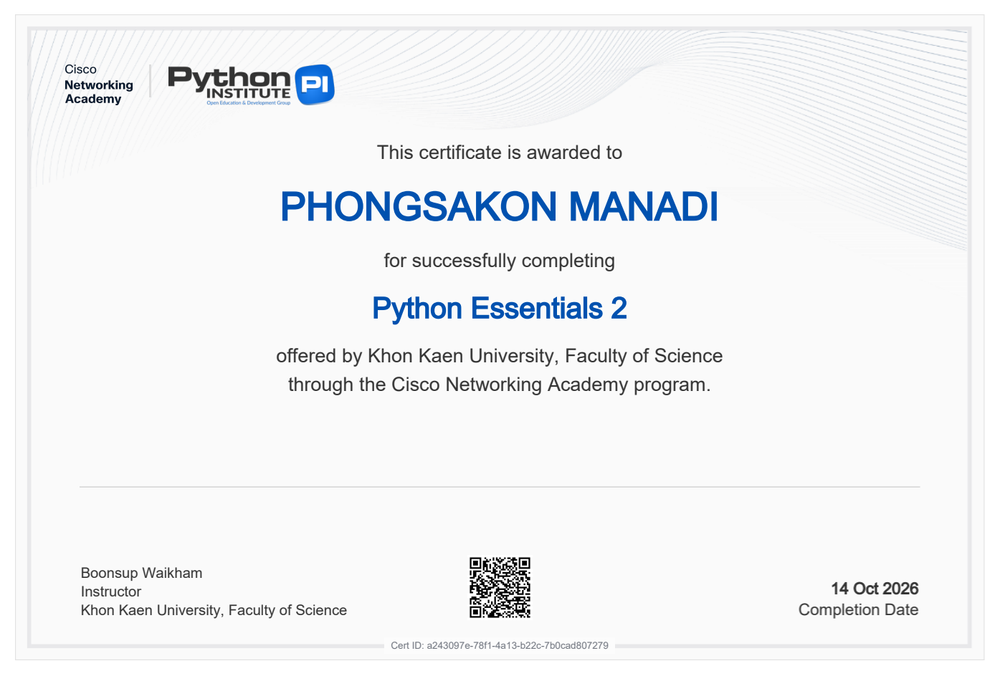
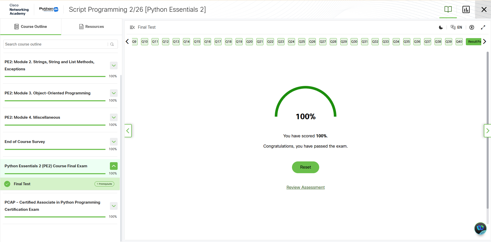

# 🎓 Certificates & Course Feedback Survey

หน้านี้รวบรวมใบประกาศนียบัตร (Certificates), ผลการสอบประเมิน (Final Exam Results) จากหลักสูตร **Cisco Networking Academy & Python Institute** พร้อมผลการตอบแบบสอบถามประเมินความพึงพอใจหลังจบหลักสูตร

# ประเมินอาจารย์ผู้สอน
**อาจารย์สอนให้รู้จักการทำงานที่เป็นระบบและการทำงานร่วมกันเป็นทีม อีกทั้งยังสอนการใช้เครื่องมือต่างๆเพื่อให้มีความชำนาญในเครื่องมือนั้นๆ และมีความรับผิดชอบต่องานที่ได้รับมอบหมายอีกด้วย และงานที่ได้ทำมีผลต่อการเรียนและการทำงานในอนาคตอย่างมาก ขอบคุณอาจารย์มากครับ**
---

## 📋 แบบสอบถามประเมินความพึงพอใจหลังจบหลักสูตร (End-of-Course Survey)

สรุปผลการตอบแบบสอบถามความคิดเห็นและความพึงพอใจสำหรับหลักสูตร Python Essentials (Cisco Networking Academy):

| ข้อที่ | หัวข้อคำถาม / แบบประเมิน | คำตอบที่เลือก | คำอธิบาย / รายละเอียดเพิ่มเติม |
| :---: | :--- | :--- | :--- |
| **1** | **ลักษณะที่ตรงกับคุณ** | นักเรียน/นักศึกษาในสถาบันที่ไม่ใช่สายเทคนิค | *Student at a non-technical school* |
| **2** | **เป้าหมายในการเรียน** | นำความรู้และทักษะไปประยุกต์ใช้ในสายงานปัจจุบันหรืออนาคตที่ไม่ใช่สายเทคโนโลยี | มุ่งเน้นการต่อยอดทักษะการเขียนโปรแกรมกับงานทั่วไปและการประยุกต์ใช้ |
| **3** | **ความพึงพอใจโดยรวมต่อคอร์ส** | พึงพอใจ | *Satisfied* |
| **4** | **ความพึงพอใจต่อผู้สอน** | พึงพอใจ | *Satisfied* |
| **5** | **ความมั่นใจในความรู้และทักษะที่ได้รับ** | มั่นใจมาก | *Very confident* |
| **6** | **แรงจูงใจในการเรียนให้ดี** | มีแรงจูงใจมาก | *Very motivated* |
| **7** | **ความคุ้มค่าต่อเวลาและความพยายามที่ทุ่มเท** | เห็นด้วย | *Agree* |
| **8** | **คอร์สนี้ช่วยส่งเสริมในด้านต่างๆ มากน้อยเพียงใด** | **ค่อนข้างมาก (*Quite a bit*)** ในทุกด้าน | • ได้ทักษะนำไปใช้ทำงานจริง • เพิ่มมูลค่าและศักยภาพในตลาดงาน • โอกาสได้งานใหม่หรือก้าวหน้าในสายงานเดิม • ช่วยส่งเสริมและเป็นพื้นฐานในการศึกษาต่อ |
| **9** | **โอกาสที่จะแนะนำ Cisco Networking Academy ให้ผู้อื่น** | **9 / 10** | มีโอกาสสูงมากที่จะแนะนำให้เพื่อนและผู้ที่สนใจศึกษาต่อ |
| **10** | **สิ่งที่ควรปรับปรุงมากที่สุด** | การแปลภาษา | *Translation* (การปรับปรุงสำนวนและการแปลเนื้อหาภาษาไทยให้กระชับและเข้าใจง่ายขึ้น) |
| **11** | **โอกาสที่จะสอบใบรับรองวิชาชีพ PCEP™** | **7 / 10** | ความสนใจและเป้าหมายในการสอบวัดระดับ Certified Entry-Level Python Programmer |

---

## 📜 ใบประกาศนียบัตรและผลการประเมิน (Certificates & Credentials)

### 1. Python Essentials 1
- **หลักสูตร:** Python Essentials 1 (Basics of Python Programming)
- **สถาบัน:** Cisco Networking Academy & OpenEDG Python Institute
- **ไฟล์เอกสาร:** [📄 ดูเอกสารฉบับเต็ม (PDF)](./Python_Essentials_1_certificate_phongsakon-m-kkumail-com_73671b1c-145e-4bdd-a391-9633de0454fc.pdf)

  
    
  

 

### 2. Python Essentials 2
- **หลักสูตร:** Python Essentials 2 (Intermediate Python & OOP)
- **สถาบัน:** Cisco Networking Academy & OpenEDG Python Institute
- **ไฟล์เอกสาร:** [📄 ดูเอกสารฉบับเต็ม (PDF)](./Python_Essentials_2_certificate_phongsakon-m-kkumail-com_a243097e-78f1-4a13-b22c-7b0cad807279.pdf)

  
    
  

