<div align="center">


---

## 👨‍🎓 Student Information

| 📌 Information | 📖 Details                            |
| :------------- | :------------------------------------ |
| **Name**       | **Pongsakorn Manadee (พงษกร มานาดี)** |
| **Year**       | 4                                     |
| **Faculty**    | College of Computing                  |
| **Major**      | Artificial Intelligence (AI)          |
| **Student ID** | **663380282-7**                       |

---

<p align="center">

*"Keep Learning • Keep Building • Keep Improving"* 🚀

</p>

</div>

---

## 🗺️ ผังภาพรวมโครงสร้างของงานทั้งหมด (Repository Roadmap)

```mermaid
flowchart TD
    Root["Script Programming Complete"] --> Part1["1. Lab (Fundamental Labs)"]
    Root --> Part2["2. Lab Activity (Applied Workshops)"]
    Root --> Part3["3. Lab X Basic (Automation Basics)"]
    Root --> Part4["4. Lab X Advance (Agent Automation)"]
    Root --> Part5["5. Projects (Mini & Final)"]

    %% Part 1: Fundamental Labs
    Part1 --> L1["Lab 1: Python Basics & Syntax"]
    Part1 --> L2["Lab 2: Conditionals & Logic"]
    Part1 --> L3["Lab 3: Loops & Iterations"]
    Part1 --> L4["Lab 4: Data Structures"]
    Part1 --> L5["Lab 5: String & Text Processing"]
    Part1 --> L6["Lab 6: Functions & Custom Modules"]
    Part1 --> L12["Lab 12: CLI Task Manager App"]

    %% Part 2: Lab Activity
    Part2 --> Act1["Activity 1: Modular Task Manager"]
    Part2 --> Act2["Activity 2: OOP Task Manager & Unit Tests"]
    Part2 --> Act3["Activity 3: Web APIs & HTTP Fetcher"]
    Part2 --> Act4["Activity 4: Enhanced Task Manager Design"]

    %% Part 3: Basic Labs
    Part3 --> B1["Week 7: Web Scraping"]
    Part3 --> B2["Week 8: CSV & JSON Handling"]
    Part3 --> B3["Week 10: Excel Automation"]
    Part3 --> B4["Week 11: PDF & Word Processing"]
    Part3 --> B5["Week 12: Email & SMS Communication"]

    %% Part 4: Advance Labs
    Part4 --> A1["Week 7: Scraper Agent (Selenium)"]
    Part4 --> A2["Week 8: Data Pipeline Agent (ETL)"]
    Part4 --> A3["Week 10: Spreadsheet Agent"]
    Part4 --> A4["Week 11: Document Agent (Watermarking/Merge)"]
    Part4 --> A5["Week 12: Communication Agent Pipeline"]

    %% Part 5: Projects
    Part5 --> P1["Mini Project: Mini Game Hub (Hangman with AI)"]
    Part5 --> P2["Final Project: Menu Roulette"]
```



---

## 📂 โครงสร้างไดเรกทอรี (Directory Tree)

```text
Script-Programing-Complete/
├── README.md                                 # แฟ้มสรุปภาพรวมและผังงานทั้งหมด
│
├── Lab/                                      # ปฏิบัติการพื้นฐานภาษา Python
│   ├── Lab1/                                 # Week 1: พื้นฐานภาษา Python, ตัวแปร และการคำนวณ
│   ├── Lab2/                                 # Week 2: คำสั่งเงื่อนไข (Conditionals) & Decision Making
│   ├── Lab3/                                 # Week 3: การวนซ้ำ (Loops: for, while) & Pattern Printing
│   ├── Lab4/                                 # Week 4: โครงสร้างข้อมูล (List, Tuple, Dict, Set)
│   ├── Lab5/                                 # Week 5: การประมวลผลข้อความและสตริง (String Operations)
│   ├── Lab6/                                 # Week 6: ฟังก์ชัน, โมดูลกำหนดเอง และการ Refactor โค้ด
│   └── Lab12/                                # Week 12: แอปพลิเคชัน CLI Task Manager พร้อม Unit Test
│
├── Lab Activity/                             # กิจกรรมเชิงปฏิบัติการประยุกต์และออกแบบระบบ
│   ├── Activity1/my-task-manager/            # Activity 1: ระบบจัดการงานแบบโมดูลาร์ (Modular Architecture)
│   ├── Activity2/my-oop-task-manager/        # Activity 2: ระบบจัดการงานเชิงวัตถุ (OOP) พร้อม Unit Testing
│   ├── Activity3/my-api-fetcher/             # Activity 3: การเชื่อมต่อ Web APIs ดึงข้อมูลผ่าน HTTP
│   └── Activity4/enhanced-task-manager-design/ # Activity 4: การออกแบบระบบจัดการงานขั้นสูง (CLI UI & Persistence)
│
├── Lab X Basic/                              # ปฏิบัติการสคริปต์อัตโนมัติระดับพื้นฐาน
│   ├── Lab 1 Basic(week7)/                   # Web Scraping ดึงข้อมูลหน้าเว็บ
│   ├── Lab 2 Basic(week8)/                   # การจัดการและแปลงข้อมูลไฟล์ CSV & JSON
│   ├── Lab 3 Basic(week10)/                  # การจัดการสเปรดชีต Excel ด้วย openpyxl
│   ├── Lab 4 Basic(week11)/                  # การจัดการเอกสาร PDF และการสร้าง Word (.docx)
│   └── Lab 5 Basic(week12)/                  # ระบบส่ง-รับอีเมลอัตโนมัติ (SMTP/IMAP) & SMS
│
├── Lab X Advance/                            # ปฏิบัติการสคริปต์อัตโนมัติระดับขั้นสูง (Agent-Based)
│   ├── Lab 1 Advance(week7)/                 # Scraper Agent ขั้นสูงควบคุมด้วย Selenium Headless
│   ├── Lab 2 Advance(week8)/                 # Data Pipeline Agent (ETL, Data Conversion & Audit)
│   ├── Lab 3 Advance(week10)/                # Spreadsheet Agent (Dynamic Formulas, Styles & Audit)
│   ├── Lab 4 Advance(week11)/                # Document Agent (Watermark, PDF Merge & Template DOCX)
│   └── Lab 5 Advance(week12)/                # Multi-channel Communication Pipeline Agent
│
├── mini Project/                             # โครงงานย่อย (Mini Project)
│   └── README.md                             # Mini Game Hub: Hangman with AI
│
└── Final Project/                            # โครงงานหลัก (Final Project)
    └── README.md                             # Menu Roulette: ระบบสุ่มและแนะนำเมนูอาหาร
```

---

## 📖 รายละเอียดเนื้อหาในแต่ละโฟลเดอร์

### 1. 📂 โฟลเดอร์ `Lab/` (Fundamental Python Labs)
กลุ่มงานปฏิบัติการฝึกทักษะการเขียนโปรแกรมภาษา Python ตั้งแต่ระดับพื้นฐานจนถึงโครงสร้างสถาปัตยกรรมซอฟต์แวร์

| โฟลเดอร์ย่อย | หัวข้อหลัก | ไฟล์สำคัญ | รายละเอียดโดยสังเขป |
| :--- | :--- | :--- | :--- |
| **`Lab1/`** | Python Fundamentals | `Sec2_Week1_Lab1_663380282_7.ipynb` | แนะนำไวยากรณ์พื้นฐาน, ตัวแปร, ชนิดข้อมูล (Data Types) และตัวดำเนินการทางคณิตศาสตร์ |
| **`Lab2/`** | Conditionals & Logic | `Lab2_1.py`<br>`Lab2_2.py`<br>`Activity.ipynb` | การใช้ `if-elif-else`, การจำแนกประเภทตัวเลข, ระบบแนะนำภาพยนตร์ตามอายุ และเกมผจญภัยในป่าเวทมนตร์แบบ Text Adventure |
| **`Lab3/`** | Loops & Iteration | `Lab3.ipynb` | การวนลูปด้วย `for` และ `while`, ตารางสูตรคูณ, นาฬิกานับถอยหลัง, เกมทายตัวเลข และการพิมพ์รูปพีระมิดดาว |
| **`Lab4/`** | Data Structures | `Lab4.ipynb` | การจัดการข้อมูลคอลเลกชัน: List, Tuple, Dictionary และ Set รวมถึงเทคนิค Comprehension |
| **`Lab5/`** | String & Text Processing | `Lab5.ipynb` | การจัดการข้อความ, String Slicing, ฟังก์ชันเมธอดของสตริง และการจัดรูปแบบข้อความ |
| **`Lab6/`** | Functions & Modularity | `Lab6.ipynb`<br>`my_utils.py` | การนิยามฟังก์ชัน, Docstring PEP 257, เครื่องคิดเลขเมนูวนลูป, สร้างโมดูล `my_utils` และการ Refactor โค้ดจาก Week 2/3 |
| **`Lab12/`** | CLI Application & OOP | `main.py`<br>`src/`<br>`tests/` | ระบบจัดการงาน (Task Manager) เชิงวัตถุ พร้อมบันทึกข้อมูลลง JSON และทดสอบด้วย Unit Test |

---

### 2. 📂 โฟลเดอร์ `Lab Activity/` (Applied Workshops & System Design)
กลุ่มกิจกรรมเชิงปฏิบัติการประยุกต์ เน้นการออกแบบโครงสร้างสถาปัตยกรรมซอฟต์แวร์ การเขียนโปรแกรมเชิงวัตถุ (OOP) และการเชื่อมต่อ Web API

| โฟลเดอร์ย่อย | หัวข้อหลัก | ไฟล์สำคัญ | รายละเอียดโดยสังเขป |
| :--- | :--- | :--- | :--- |
| **`Activity1/`** | Modular Task Manager | `main.py`<br>`src/task_data.py`<br>`src/task_logic.py` | การออกแบบระบบจัดการงานแบบแยกส่วน (Separation of Concerns) แยกชั้นการเก็บข้อมูลและชั้นตรรกะทางธุรกิจ |
| **`Activity2/`** | OOP Task Manager & Testing | `solution/main.py`<br>`src/task.py`<br>`tests/test_task.py`<br>`colab/` | พัฒนาระบบจัดการงานเชิงวัตถุ (OOP) พร้อมคลาส `Task`, `TaskManager` และชุดทดสอบ `unittest` ครอบคลุมทุกฟังก์ชัน |
| **`Activity3/`** | Web APIs & HTTP Fetcher | `main.py`<br>`src/api_client.py`<br>`assignments/`<br>`colab/` | สคริปต์เชื่อมต่อ REST API ดึงข้อมูล Posts, Todos และ Users จาก JSONPlaceholder ผ่าน HTTP Requests ด้วย `requests` |
| **`Activity4/`** | Enhanced Task Manager Design | `main.py`<br>`PLAN.md`<br>`src/cli_interface.py`<br>`src/data_persistence.py` | สถาปัตยกรรมระบบจัดการงานขั้นสูง แยกส่วน CLI Interface, Data Persistence และวางแผนระบบด้วย `PLAN.md` |

---

### 3. 📂 โฟลเดอร์ `Lab X Basic/` (Script Automation Basics)
กลุ่มงานปฏิบัติการสคริปต์อัตโนมัติสำหรับการจัดการข้อมูลและเอกสารในรูปแบบต่าง ๆ

| โฟลเดอร์ย่อย | หัวข้อหลัก | ไฟล์สำคัญ | รายละเอียดโดยสังเขป |
| :--- | :--- | :--- | :--- |
| **`Lab 1 Basic(week7)`** | Web Scraping | `main.py`<br>`src/scraper.py` | สคริปต์ดึงข้อมูลสินค้าและราคาสินค้าจากหน้าเว็บไซต์ |
| **`Lab 2 Basic(week8)`** | CSV & JSON Automation | `main.py`<br>`src/csv_handler.py`<br>`src/json_handler.py` | ระบบอ่าน-เขียน กรองข้อมูลยอดขาย (Sales) และอัปเดตคลังสินค้า (Inventory) ระหว่าง CSV กับ JSON |
| **`Lab 3 Basic(week10)`** | Excel Automation | `main.py`<br>`src/excel_processor.py` | การอ่านและสร้างรายงานสรุปยอดขายบนไฟล์ Excel (.xlsx) อัตโนมัติด้วยไลบรารี `openpyxl` |
| **`Lab 4 Basic(week11)`** | PDF & Word Processing | `main.py`<br>`src/pdf_processor.py`<br>`src/word_processor.py` | การรวมไฟล์ PDF (PDF Merge), สกัดข้อความ และการสร้างรายงานสรุปผลในรูปแบบ Word (.docx) |
| **`Lab 5 Basic(week12)`** | Communication Automation | `main.py`<br>`src/email_sender.py`<br>`src/sms_gateway.py` | ระบบส่งอีเมลแจ้งเตือนอัตโนมัติพร้อมไฟล์แนบ (SMTP) และเกตเวย์จำลองส่งข้อความ SMS |

---

### 4. 📂 โฟลเดอร์ `Lab X Advance/` (Enterprise Agent-Based Automation)
กลุ่มงานปฏิบัติการสคริปต์อัตโนมัติระดับวิศวกรรมซอฟต์แวร์ ออกแบบโดยใช้สถาปัตยกรรม **Agent-Based Architecture**, ทำงานผ่านไฟล์ตั้งค่า (Config-Driven) และมีระบบบันทึก Audit Log

| โฟลเดอร์ย่อย | สถาปัตยกรรม Agent | ไฟล์สำคัญ | รายละเอียดโดยสังเขป |
| :--- | :--- | :--- | :--- |
| **`Lab 1 Advance(week7)`** | Scraper Agent | `main.py`<br>`src/scraper_agent.py`<br>`configs/` | บอทดูดข้อมูลเว็บขั้นสูงด้วย Selenium แบบ Headless Browser รองรับเว็บที่เรนเดอร์ด้วย JavaScript |
| **`Lab 2 Advance(week8)`** | Data Pipeline Agent | `main.py`<br>`src/data_agent.py`<br>`reports/` | ไปป์ไลน์ประมวลผลข้อมูล (ETL Pipeline) แปลงข้อมูลข้ามฟอร์แมต ตรวจสอบความถูกต้อง พร้อมสร้าง Audit Report |
| **`Lab 3 Advance(week10)`** | Spreadsheet Agent | `main.py`<br>`src/spreadsheet_agent.py`<br>`data/` | บอทสร้างรายงาน Excel อัตโนมัติ ใส่สูตรคำนวณไดนามิก จัดแต่งรูปแบบตาราง และสร้างแผนภูมิ |
| **`Lab 4 Advance(week11)`** | Document Agent | `main.py`<br>`src/document_agent.py`<br>`templates/` | ระบบจัดทำเอกสารอัตโนมัติ: ปั๊มลายน้ำ (Watermark), รวมเอกสารหลายชุด และสร้างรายงานตามแม่แบบ (Template) |
| **`Lab 5 Advance(week12)`** | Communication Pipeline Agent | `main.py`<br>`src/communication_agent.py` | ระบบส่งการแจ้งเตือนหลายช่องทาง (Multi-channel Dispatch) ผสาน Template Engine และเก็บประวัติการส่งอย่างละเอียด |

---

### 5. 📂 โฟลเดอร์โครงงาน (Projects)

#### 🎮 `mini Project/` — Mini Game Hub (Hangman with AI)
* **หัวข้อ:** ศูนย์รวมมินิเกมและเกม Hangman ที่ขับเคลื่อนด้วยการจำลองตรรกะ AI
* **คลังโค้ด:** [github.com/Mametoyas/SP-MiniProject](https://github.com/Mametoyas/SP-MiniProject)
* **รายละเอียด:** พัฒนาเกมอักษรปริศนาโต้ตอบ มีระบบวิเคราะห์คำศัพท์และความยาก-ง่ายตามระดับผู้เล่น

#### 🎰 `Final Project/` — Menu Roulette
* **หัวข้อ:** ระบบสุ่มและแนะนำเมนูอาหารอัจฉริยะ (Menu Roulette)
* **คลังโค้ด:** [github.com/Mametoyas/Menu-Roulette](https://github.com/Mametoyas/Menu-Roulette)
* **รายละเอียด:** แอปพลิเคชันช่วยตัดสินใจเลือกรับประทานอาหาร คัดกรองตามหมวดหมู่ งบประมาณ และความชอบของผู้ใช้งาน

---

## 🛠️ เทคโนโลยีและเครื่องมือที่ใช้ (Tech Stack)

<div align="center">

### 💻 Languages & Development Environments
[](https://www.python.org/)
[](https://jupyter.org/)
[](https://colab.research.google.com/)
[](https://code.visualstudio.com/)
[](https://git-scm.com/)
[](https://github.com/)

### 🌐 Web Scraping & REST APIs
[](https://www.selenium.dev/)
[](https://requests.readthedocs.io/)
[](https://www.crummy.com/software/BeautifulSoup/)
[](https://restfulapi.net/)

### 📊 Data Processing & Spreadsheets
[](https://pandas.pydata.org/)
[-217346?style=for-the-badge&logo=microsoftexcel&logoColor=white)](https://openpyxl.readthedocs.io/)
[](https://www.json.org/)
[](https://docs.python.org/3/library/csv.html)

### 📄 Document & Communication Automation
[](https://pypdf.readthedocs.io/)
[](https://python-docx.readthedocs.io/)
[](https://docs.python.org/3/library/smtplib.html)
[](https://www.twilio.com/)

### 🧪 Testing & Code Quality
[](https://docs.python.org/3/library/unittest.html)
[](https://peps.python.org/pep-0257/)
[](https://docs.python.org/3/library/typing.html)

</div>

<br>

| หมวดหมู่ (Category) | เครื่องมือ / ไลบรารี | บทบาทและการประยุกต์ใช้ในโครงการ (Application) |
| :--- | :--- | :--- |
| **Core & Env** | `Python 3.11+`, `Jupyter`, `VS Code` | สภาพแวดล้อมหลักในการพัฒนา, รันสคริปต์ และสมุดงานวิเคราะห์ |
| **Web Scraping** | `Selenium`, `BeautifulSoup4`, `Requests` | ดึงข้อมูลหน้าเว็บทั้งแบบ Dynamic DOM ด้วย Headless Chrome และ Static HTML |
| **REST APIs** | `Requests`, `JSON` | เชื่อมต่อ Web Service, ดึงข้อมูล JSONPlaceholder และตรวจสอบ HTTP Status Code |
| **Data Pipelines** | `OpenPyXL`, `Pandas`, `CSV`, `JSON` | ระบบ ETL แปลงข้อมูล จัดการสเปรดชีต ใส่สูตรคำนวณ และสร้างรายงานอัตโนมัติ |
| **Documents** | `PyPDF`, `Python-Docx` | ประมวลผลเอกสาร PDF (Merge, Watermark) และสร้างรายงาน Word ตาม Template |
| **Communication** | `smtplib`, `email.mime`, `SMS Gateway` | ส่งอีเมลแจ้งเตือนอัตโนมัติพร้อมเอกสารแนบ และระบบส่งข้อความแจ้งเตือนจำลอง |
| **Quality & Tests** | `unittest`, `Type Hints`, `PEP 257` | เขียนชุดทดสอบฟังก์ชันและคลาส เพิ่มความน่าเชื่อถือและมาตรฐานสากล |
