<div align="center">


---

## 👨‍🎓 Student Information

| 📌 Information | 📖 Details                            |
| :------------- | :------------------------------------ |
| **Name**       | **Pongsakorn Manadee (พงษกร มานาดี)** |
| **Year**       | 4                                     |
| **Faculty**    | College of Computing                  |
| **Major**      | Artificial Intelligence (AI)          |
| **Student ID** | **663380282-7**                       |

---

<p align="center">

*"Keep Learning • Keep Building • Keep Improving"* 🚀

</p>

</div>

---

## 🗺️ ผังภาพรวมโครงสร้างของงานทั้งหมด (Repository Roadmap)

```mermaid
flowchart TD
    Root["Script Programming Complete"] --> Part1["1. Lab (Fundamental Labs)"]
    Root --> Part2["2. Lab Activity (Applied Workshops)"]
    Root --> Part3["3. Lab X Basic (Automation Basics)"]
    Root --> Part4["4. Lab X Advance (Agent Automation)"]
    Root --> Part5["5. Projects (Mini & Final)"]

    %% Part 1: Fundamental Labs
    Part1 --> L1["Lab 1: Python Basics & Syntax"]
    Part1 --> L2["Lab 2: Conditionals & Logic"]
    Part1 --> L3["Lab 3: Loops & Iterations"]
    Part1 --> L4["Lab 4: Data Structures"]
    Part1 --> L5["Lab 5: String & Text Processing"]
    Part1 --> L6["Lab 6: Functions & Custom Modules"]
    Part1 --> L12["Lab 12: CLI Task Manager App"]

    %% Part 2: Lab Activity
    Part2 --> Act1["Activity 1: Modular Task Manager"]
    Part2 --> Act2["Activity 2: OOP Task Manager & Unit Tests"]
    Part2 --> Act3["Activity 3: Web APIs & HTTP Fetcher"]
    Part2 --> Act4["Activity 4: Enhanced Task Manager Design"]

    %% Part 3: Basic Labs
    Part3 --> B1["Week 7: Web Scraping"]
    Part3 --> B2["Week 8: CSV & JSON Handling"]
    Part3 --> B3["Week 10: Excel Automation"]
    Part3 --> B4["Week 11: PDF & Word Processing"]
    Part3 --> B5["Week 12: Email & SMS Communication"]

    %% Part 4: Advance Labs
    Part4 --> A1["Week 7: Scraper Agent (Selenium)"]
    Part4 --> A2["Week 8: Data Pipeline Agent (ETL)"]
    Part4 --> A3["Week 10: Spreadsheet Agent"]
    Part4 --> A4["Week 11: Document Agent (Watermarking/Merge)"]
    Part4 --> A5["Week 12: Communication Agent Pipeline"]

    %% Part 5: Projects
    Part5 --> P1["Mini Project: Mini Game Hub (Hangman with AI)"]
    Part5 --> P2["Final Project: Menu Roulette"]
```



---

## 📂 โครงสร้างไดเรกทอรี (Directory Tree)

```text
Script-Programing-Complete/
├── README.md                                 # แฟ้มสรุปภาพรวมและผังงานทั้งหมด
│
├── Lab/                                      # ปฏิบัติการพื้นฐานภาษา Python
│   ├── Lab1/                                 # Week 1: พื้นฐานภาษา Python, ตัวแปร และการคำนวณ
│   ├── Lab2/                                 # Week 2: คำสั่งเงื่อนไข (Conditionals) & Decision Making
│   ├── Lab3/                                 # Week 3: การวนซ้ำ (Loops: for, while) & Pattern Printing
│   ├── Lab4/                                 # Week 4: โครงสร้างข้อมูล (List, Tuple, Dict, Set)
│   ├── Lab5/                                 # Week 5: การประมวลผลข้อความและสตริง (String Operations)
│   ├── Lab6/                                 # Week 6: ฟังก์ชัน, โมดูลกำหนดเอง และการ Refactor โค้ด
│   └── Lab12/                                # Week 12: แอปพลิเคชัน CLI Task Manager พร้อม Unit Test
│
├── Lab Activity/                             # กิจกรรมเชิงปฏิบัติการประยุกต์และออกแบบระบบ
│   ├── Activity1/my-task-manager/            # Activity 1: ระบบจัดการงานแบบโมดูลาร์ (Modular Architecture)
│   ├── Activity2/my-oop-task-manager/        # Activity 2: ระบบจัดการงานเชิงวัตถุ (OOP) พร้อม Unit Testing
│   ├── Activity3/my-api-fetcher/             # Activity 3: การเชื่อมต่อ Web APIs ดึงข้อมูลผ่าน HTTP
│   └── Activity4/enhanced-task-manager-design/ # Activity 4: การออกแบบระบบจัดการงานขั้นสูง (CLI UI & Persistence)
│
├── Lab X Basic/                              # ปฏิบัติการสคริปต์อัตโนมัติระดับพื้นฐาน
│   ├── Lab 1 Basic(week7)/                   # Web Scraping ดึงข้อมูลหน้าเว็บ
│   ├── Lab 2 Basic(week8)/                   # การจัดการและแปลงข้อมูลไฟล์ CSV & JSON
│   ├── Lab 3 Basic(week10)/                  # การจัดการสเปรดชีต Excel ด้วย openpyxl
│   ├── Lab 4 Basic(week11)/                  # การจัดการเอกสาร PDF และการสร้าง Word (.docx)
│   └── Lab 5 Basic(week12)/                  # ระบบส่ง-รับอีเมลอัตโนมัติ (SMTP/IMAP) & SMS
│
├── Lab X Advance/                            # ปฏิบัติการสคริปต์อัตโนมัติระดับขั้นสูง (Agent-Based)
│   ├── Lab 1 Advance(week7)/                 # Scraper Agent ขั้นสูงควบคุมด้วย Selenium Headless
│   ├── Lab 2 Advance(week8)/                 # Data Pipeline Agent (ETL, Data Conversion & Audit)
│   ├── Lab 3 Advance(week10)/                # Spreadsheet Agent (Dynamic Formulas, Styles & Audit)
│   ├── Lab 4 Advance(week11)/                # Document Agent (Watermark, PDF Merge & Template DOCX)
│   └── Lab 5 Advance(week12)/                # Multi-channel Communication Pipeline Agent
│
├── mini Project/                             # โครงงานย่อย (Mini Project)
│   └── MiniProject.md                        # Mini Game Hub: Hangman with AI
│
└── Final Project/                            # โครงงานหลัก (Final Project)
    └── FinalProject.md                       # Menu Roulette: ระบบสุ่มและแนะนำเมนูอาหาร
```

## 🛠️ เทคโนโลยีและเครื่องมือที่ใช้ (Tech Stack)

* **Language:** Python 3.11+
* **Environment:** Jupyter Notebook / Google Colab / VS Code
* **Core Libraries:**
  * **Data & Automation:** `openpyxl`, `python-docx`, `pypdf`, `pandas`
  * **Web Scraping & APIs:** `selenium`, `beautifulsoup4`, `requests`
  * **System & Protocols:** `smtplib`, `email`, `pathlib`, `json`, `csv`, `datetime`, `collections`
  * **Testing & Quality:** `unittest`, `PEP 257 Docstrings`, `Type Annotations`
